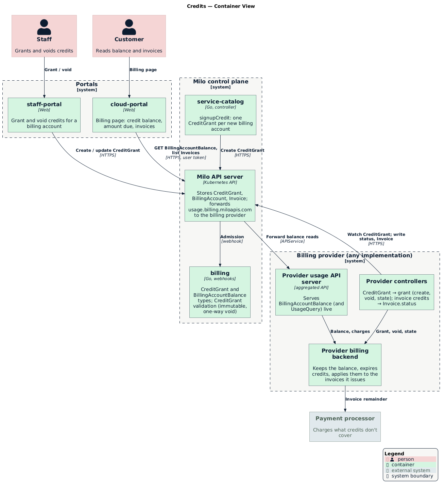
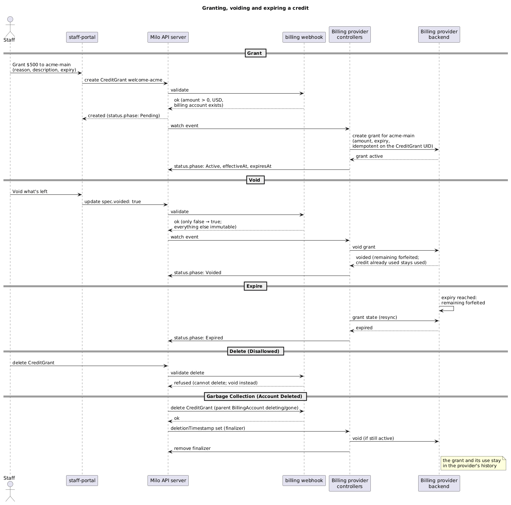
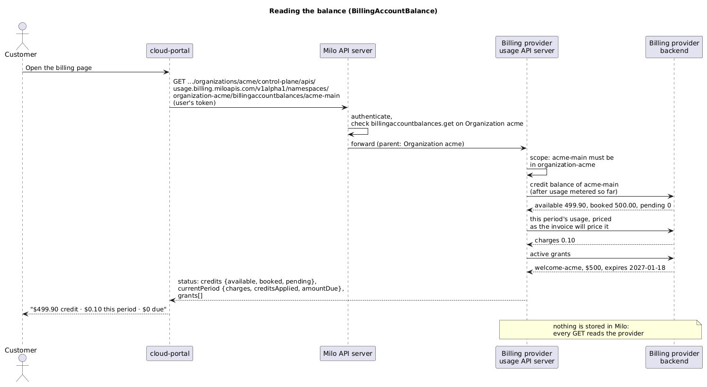
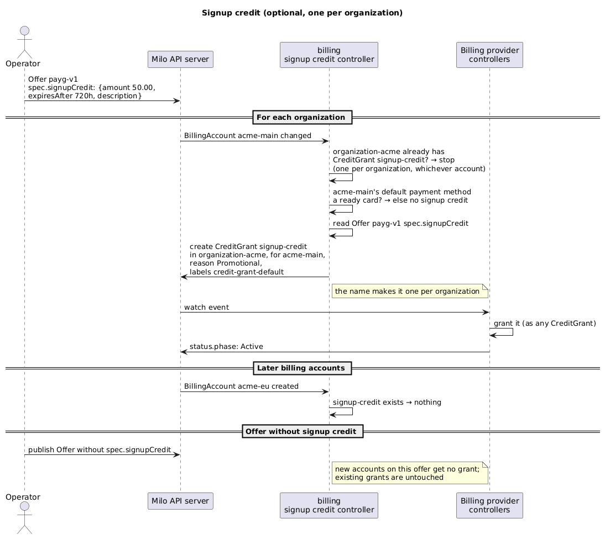
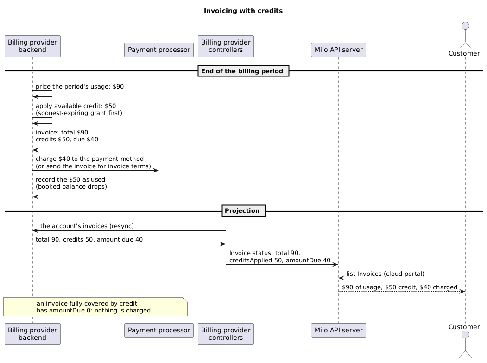

<!-- omit from toc -->
# Credits

- [Summary](#summary)
- [Motivation](#motivation)
  - [Goals](#goals)
  - [Non-Goals](#non-goals)
- [Proposal](#proposal)
  - [How It Works](#how-it-works)
  - [User Stories](#user-stories)
  - [Notes and Constraints](#notes-and-constraints)
  - [Risks and Mitigations](#risks-and-mitigations)
- [Design Details](#design-details)
  - [CreditGrant Resource](#creditgrant-resource)
  - [BillingAccountBalance Resource](#billingaccountbalance-resource)
  - [Signup Credit](#signup-credit)
  - [Invoices](#invoices)
  - [What Lives Where](#what-lives-where)
  - [Provider Requirements](#provider-requirements)
  - [IAM](#iam)
  - [Diagrams](#diagrams)
- [Rollout](#rollout)
- [Open Questions](#open-questions)
- [Future Work](#future-work)
- [Alternatives](#alternatives)

## Summary

A billing account can hold **credits**: a dollar balance that usage draws
down before anything is charged to a payment method. Staff grant credits
with a `CreditGrant` (`billing.miloapis.com/v1alpha1`), a record of who got
how much, why, and until when. Customers and staff read the account's
running balance with `BillingAccountBalance`
(`usage.billing.miloapis.com/v1alpha1`), which is served live from the
billing provider instead of being copied into Milo. Optionally, every new
organization gets a signup credit configured on the billing service.

Billing defines the API and doesn't know how credits are kept. The billing
provider keeps the balance and applies credits to the invoices it issues: a
$90 invoice on an account with $50 of credit asks the payment method for
$40.

## Motivation

Today every dollar of usage is invoiced and charged to the account's
payment method. We can't:

- give a new customer, or a friend we invite, $500 to get started;
- sponsor nonprofits, education or partners. [Billing
  Arrangements](../billing-arrangements.md) decided sponsored access will be
  "a credit added to a normal billable account (like AWS startup credits)"
  and deferred it "until invoicing supports credits";
- make goodwill corrections without refunding payments by hand.

Customers also can't see a running total of what they owe. The billing page
shows usage and, with `UsageQuery`'s `includeSpend`, its cost, but not a
balance that moves as they use the platform.

### Goals

- Staff grant a dollar amount of credit to a billing account, with a reason
  and an optional expiry, and can void what's left of it.
- Usage draws credits down first; invoices only charge the remainder.
- The account's balance is visible as it changes, not only at invoice time:
  a customer with $500 who runs an instance all day sees about $499.90 the
  next morning.
- Every grant is an auditable Milo resource: who granted what, to whom,
  when, why.
- No copy of the balance in Milo. The billing provider is the source of
  truth, read on request.
- Independent of the billing provider: billing defines the API and what a
  provider must do, not how.
- Optionally, a signup credit for every new organization, configured, not
  coded.

### Non-Goals

- **Customers buying credits** (prepaid top-ups). This is about promotional
  and sponsored credit. See [Future Work](#future-work).
- **Credits limited to some services or meters.** A credit pays for any
  usage.
- **Recurring credits** (e.g. $10 every month). Grants are one-off.
- **Referral or promo-code flows.** They can create `CreditGrant`s later;
  this enhancement is the primitive they would use.
- **Prepaid-only offerings** where usage is blocked when credits run out.
  Usage beyond the credit is invoiced as today.

## Proposal

### How It Works



Who does what:

- **billing** defines `CreditGrant` and `BillingAccountBalance` and
  validates grants (immutable, one-way void). It holds no balance.
- **service-catalog** creates a signup `CreditGrant` once per organization,
  if the billing ServiceConfiguration sets `signupCredit`.
- **The billing provider** does the rest, behind Milo's API:
  - its controllers turn each `CreditGrant` into a grant in its ledger, void
    it, report its state, and copy invoice credits into `Invoice.status`;
  - its usage API server answers `BillingAccountBalance` reads live;
  - it keeps the balance, expires credits, and deducts them from the
    invoices it issues before the payment processor charges the rest.
- **The portals** only talk to Milo: staff-portal grants and voids,
  cloud-portal shows the balance and invoices.

The API has three pieces:

1. **`CreditGrant`** is a Kubernetes resource in the billing account's
   namespace. It is the grant's record, mostly immutable once created. The
   provider turns it into a grant in its ledger and reports its state.
2. **`BillingAccountBalance`** is read-only and never stored, like
   `UsageQuery`. A `GET` returns the account's credit balance and what it
   owes this period, computed by the provider at that moment.
3. **Signup credit** is an optional setting on the commercial `Offer`
   (`billing.miloapis.com/v1alpha1`). billing's signup credit controller creates one
   `CreditGrant` per organization when an entitled billing account attaches a ready
   payment card.

> [!NOTE]
> Credits are used automatically. All of a billing account's usage draws
> from its credits first, from the moment a credit is active, and each
> invoice deducts the available credit before anything is charged. The
> customer can't choose when to use them, save them for later, or pay by
> card instead.

### User Stories

- As staff, I give a friend we invited $500 of credit so they can try the
  platform. Their usage comes out of it, and their card isn't charged until
  it runs out.
- As staff, I sponsor a nonprofit with $5,000 for a year, the "sponsored
  access" path from Billing Arrangements.
- As staff, I make a goodwill correction after an incident by granting a
  credit, and I can see later who granted it and why.
- As staff, I void what's left of a credit that was granted by mistake.
- As a customer, I open the billing page and see my credit balance and what
  I owe this period, updated through the day.
- As a customer, my invoice shows the usage, the credit applied, and the
  amount charged.
- As a platform operator, I configure that every new organization starts
  with $50 of credit that expires after 30 days, without a code change.

### Notes and Constraints

- **Credits belong to billing accounts,** not users, organizations or
  projects: the billing account is who pays. An organization can have
  several billing accounts, and a credit only pays for the usage of the
  projects bound to its own billing account. Projects billed to another of
  the organization's accounts are charged as usual.
- **One signup credit per organization,** so creating more billing accounts
  in the same organization doesn't earn more credit.
- **USD only,** like every price today.
- **Order of use:** the grant expiring first is used first. Expired credit
  is forfeited.
- **Usage beyond the credit is invoiced as today,** charged to the account's
  payment method or invoice terms.
- **The live balance is an estimate between invoices.** It prices usage
  metered so far, the same way the invoice will (as `UsageQuery` spend
  does). The amount actually deducted is fixed when the invoice is issued.
- **A grant isn't edited.** To change one, void it and grant again.

### Risks and Mitigations

| Risk | Mitigation |
| --- | --- |
| Applying credits changes how the provider builds every invoice, not only for accounts with credits | The provider proves its existing invoices are unchanged (its end-to-end invoice tests) before turning credits on, and rolls out on staging first, comparing an invoice before and after |
| A provider's credit support is new or limited | [Provider Requirements](#provider-requirements) lists what a provider must support; a provider that can't meet one doesn't serve credits yet (grants stay `Pending` with a condition) |
| Signup credits invite abuse (many accounts or organizations to collect free credit) | Manual credit delivery is the primary mechanism (MVP) until automated fraud prevention is established. For automated signup credits (future/optional): off by default; small amounts with short expiry; once per organization **and once per payment card**, so more billing accounts, more organizations or more users paying with the same card earn nothing more; only for accounts paying by a ready card, after signup fraud checks |
| A grant in Milo and the provider disagree | The provider is authoritative. `CreditGrant` stores no balance, only its state; the provider re-checks it on every resync |
| Staff grant the wrong amount | Grants are immutable: void and grant again. The provider keeps both in its history |

## Design Details

### CreditGrant Resource



```yaml
apiVersion: billing.miloapis.com/v1alpha1
kind: CreditGrant
metadata:
  name: welcome-acme
  namespace: organization-acme        # the billing account's namespace
spec:
  billingAccountRef:
    name: acme-main
  amount: "500.00"                    # decimal string, > 0
  currency: USD
  reason: Promotional                 # Promotional | Sponsorship | Goodwill
  description: "Invited at KubeCon"   # free text, required
  expiresAfter: 2160h                 # optional duration from effective time; omitted = never
  voided: false                       # one-way: true voids what's left
status:
  phase: Active                       # Pending | Active | Expired | Voided | Failed
  effectiveAt: "2026-10-20T14:00:00Z"
  expiresAt: "2027-01-18T14:00:00Z"
  conditions:
    - type: Ready                     # False with a reason when the provider couldn't apply it
      status: "True"
```

- **Immutable except `voided`,** enforced by billing's webhook. `voided`
  only goes from `false` to `true`.
- **Voiding forfeits what's left.** Credit already used stays used.
- **Deleting a CreditGrant is refused by billing's webhook.** Voiding (`voided: true`)
  is the only mechanism to cancel or forfeit a grant, keeping an immutable audit
  trail in Milo. Kubernetes garbage collection deletes grants when the parent
  BillingAccount is deleting or deleted; the provider voids any active balance during
  cascade delete before removing its finalizer.
- **The provider links the CreditGrant to its own grant** however it links
  other resources (for example, an annotation in its own domain), and uses
  the CreditGrant UID so a retry never grants twice.
- **No `remaining` in status:** that is the provider's number and changes
  with every metered event. Read it from `BillingAccountBalance`.
- **The billing account must exist** in the same namespace (webhook), and
  the grant waits as `Pending` until the provider has its customer.

### BillingAccountBalance Resource

A read-only aggregated resource in `usage.billing.miloapis.com/v1alpha1`,
next to `UsageQuery`, served by the same provider API server (the usage
provider's aggregated API). It supports
`get` and `list` in the billing account's namespace and is never stored.



```yaml
apiVersion: usage.billing.miloapis.com/v1alpha1
kind: BillingAccountBalance
metadata:
  name: acme-main                     # the billing account's name
  namespace: organization-acme
status:
  retrievedAt: "2026-11-10T09:00:00Z"
  currency: USD
  balance:                            # posted
    creditRemaining: "130.00"         # 80 (welcome) + 50 (goodwill)
    amountOwed: "75.00"               # past invoices outstanding (e.g. card declined)
  forecast:                           # current billing period so far, not invoiced
    periodStart: "2026-11-01T00:00:00Z"
    periodEnd: "2026-12-01T00:00:00Z"
    estimatedSpend: "60.00"
    estimatedCreditUsed: "60.00"
    estimatedAmountDue: "0.00"
    estimatedCreditRemaining: "70.00"
  grants:                             # active grants, soonest-expiring first
    - name: welcome-acme
      amount: "500.00"
      used: "420.00"                  # by past invoices
      remaining: "80.00"
      expiresAt: "2027-01-01T00:00:00Z"
    - name: support-goodwill
      amount: "50.00"
      used: "0.00"
      remaining: "50.00"              # no expiry
```

- **`balance` represents posted ledger state:**
  - `creditRemaining`: Total posted credit balance remaining across all grants.
  - `amountOwed`: Total unpaid/outstanding amount from finalized invoices.
- **`forecast` represents un-invoiced, forward-looking activity for the current period:**
  - `estimatedSpend`: Metered usage charges accumulated so far this period, priced as the invoice will price it.
  - `estimatedCreditUsed`: Amount of available credit projected to offset current period spend.
  - `estimatedAmountDue`: Projected amount that will be due if invoiced now (`estimatedSpend` − `estimatedCreditUsed`).
  - `estimatedCreditRemaining`: Projected credit remaining after covering current period spend.
- **`grants` lists individual active grants:** Includes total granted `amount`, `used` by posted invoices, `remaining`, and optional `expiresAt`.
- **A billing account with no credits** still has a balance: `creditRemaining: "0.00"` and reports current period forecast, providing a unified place to read accrued charges and account balance.
- **Accounts on several billing periods** (rare) report the current one.

### Signup Credit



An optional `signupCredit` field on the commercial `Offer` (`billing.miloapis.com/v1alpha1`), allowing each commercial plan/tier to specify welcome credits awarded upon account onboarding. Manual credit granting is the primary mechanism for MVP (e.g. promotional grants for trusted accounts); automated signup credit delivery is optional and configured per Offer.

```yaml
apiVersion: billing.miloapis.com/v1alpha1
kind: Offer
metadata:
  name: payg-v1
spec:
  launchStage: GA
  chargeTypes: [Usage]
  signupCredit:
    amount: "50.00"
    currency: USD
    expiresAfter: 720h
    description: "Welcome credit"
```

When an Offer specifies `signupCredit`, billing's signup credit controller creates **one `CreditGrant` per organization**. It goes to whichever of the organization's billing accounts entitled to that GA Offer is first to have a ready card as its default payment method.

The grant is named `signup-credit` in the organization's namespace, with
reason `Promotional` and the label:
`services.miloapis.com/credit-grant-default=true`.

- **One per organization, guaranteed by its name.** A namespace can only
  hold one `signup-credit`, so a second billing account, or the same
  organization reconciled twice, can't get another.
- **Only accounts paying by card.** An account on an approved arrangement
  (invoice terms) has no card to check, so it gets no automatic signup
  credit. Staff reviewed it anyway and can grant one by hand.
- **Only for organizations whose first billing account is set up after the
  setting exists.** Existing organizations get nothing retroactively.
- **Void it rather than delete it.** Deleting CreditGrants is refused by billing's
  webhook (voiding is the only mechanism), preventing a deleted `signup-credit` from
  re-triggering automatic grants.
- **Removing the setting stops new grants;** existing ones are untouched.

This keeps every credit a `CreditGrant`: one way to audit, void and display
them, whoever created them.

### Invoices



- The provider projects the invoice's credits into the Milo `Invoice`
  status as a new field, `creditsApplied`. `total` stays the usage before
  credits, and `amountDue` is what's left to pay.
- The invoice the customer receives shows the credit as a deduction.
- An invoice fully covered by credits has `amountDue: 0` and nothing is
  charged.

### What Lives Where

| Piece | Repository |
| --- | --- |
| `CreditGrant` type, webhook (immutability, billing account, amount), RBAC roles | billing |
| `BillingAccountBalance` type and validation (`api/usage/v1alpha1`), `ProtectedResource`, discovery | billing |
| `Invoice.status.creditsApplied` | billing |
| `signupCredit` on ServiceConfiguration, grant creation for new accounts | service-catalog |
| Grant sync, void on `voided` or cascade delete, `BillingAccountBalance` serving, invoice credits projection | billing provider |
| Billing page: balance, credits, invoice credit line | cloud-portal |
| Grant and void credits for an account | staff-portal |

### Provider Requirements

What a billing provider must do to serve credits. How it does it is the
provider's own design.

| Requirement | Detail |
| --- | --- |
| Grant | Create a grant of a USD amount for the billing account, with an optional expiry, idempotently (a retried grant never grants twice) |
| Void | Forfeit what's left of a grant when `voided: true` or during cascade delete; credit already used stays used. Idempotent |
| State | Report a grant as pending, active, expired or voided |
| Order of use | Use the grant expiring first first; forfeit expired credit |
| Live balance | Report the balance after the usage metered so far, before it is invoiced, priced as the invoice will price it |
| Invoices | Deduct available credit from each invoice before charging the rest; report the credit applied per invoice |
| History | Keep every grant, use, expiry and void, for audit |

A provider that can't meet a requirement leaves `CreditGrant`s `Pending`
with a condition explaining why, and doesn't serve `BillingAccountBalance`
credits.

### IAM

- `CreditGrant`: create and update (void) for staff only (direct deletion is refused),
  through a new `billing.miloapis.com-credit-admin` role bound to staff in infra.
  Organization members with billing view access can `get` and `list` them
  (`billing.miloapis.com-viewer`).
- `BillingAccountBalance`: `ProtectedResource` with permission `get`, parent
  Organization, granted by the existing usage viewer role, so everyone who
  can view billing can view the balance. Staff read any account through a
  platform binding, as with `UsageQuery`.
- service-catalog's controller needs `create` and cluster-wide `list` on
  `creditgrants`, and `get` on `paymentmethods`, for signup credits.

### Diagrams

The PlantUML sources are next to this file (`*.puml`). Regenerate the PNGs
with:

```sh
docker run --rm -v "$PWD":/data plantuml/plantuml -tpng '/data/*.puml'
```

## Rollout

1. **billing:** `CreditGrant`, `BillingAccountBalance` and
   `Invoice.status.creditsApplied`.
2. **Billing provider:** grant sync, balance API, invoice projection. Its
   existing invoices must come out unchanged with credits on, and it adds
   end-to-end tests for a grant, the live balance, an invoice partly and
   fully covered by credit, void and expiry. Staging first.
3. **Portals:** the balance on cloud-portal's billing page, and granting and
   voiding in staff-portal.
4. **service-catalog:** `signupCredit`, left unset until product decides the
   amount.

## Open Questions

1. **Signup credit at all, and how much?** It's optional in this design.
   Product decides whether to set it, the amount and the expiry.
2. **Who can grant?** Staff only in v0. Should support be capped (for
   example, grants over $1,000 need a second approver)?
3. **Delete or void.** Resolved: deleting a `CreditGrant` is refused by the webhook.
   Voiding is the only mechanism to cancel a credit, preserving an immutable audit trail in Milo.
   (The only exception is cascading deletion when the parent `BillingAccount` is deleted/gone).
4. **Shown on invoices how?** One "Credit applied" line, or the credit
   spread over the lines it paid for? Providers may only support one of
   them.
5. **Accounts without a card.** Sponsored accounts may have no payment
   method. Sponsorship by credit depends on the provider billing accounts
   that have none.

## Future Work

- Customers buying credits (grants paid by invoice or externally).
- Credits limited to services.
- Recurring credits, referral and promo-code flows that create grants.
- Low-balance notifications ("you have $10 of credit left").
- The credit history (grants, use, expiry) in the portal.

## Alternatives

- **Balance as `BillingAccount.status`, synced on an interval.** Simple to
  read and watchable, but it copies the ledger into Milo, is stale between
  syncs, and writes to every account on every interval. Rejected for a live
  read, like `UsageQuery`.
- **A `CreditPolicy` (or `CreditProgram`) resource** with selectors and
  amounts, for signup, referral and campaigns. More general, but there is
  one rule today, and a field next to `defaultOffer` covers it. A policy
  resource can come later and create the same `CreditGrant`s.
- **Signup credits in code,** for example in service-catalog with an amount
  from a flag. No API to review and a deploy for every change; the
  ServiceConfiguration field is just as simple and can be changed by staff.
- **Credits as part of an Offer.** An Offer is a price list shared by many
  accounts and immutable once published, while credits are per account and
  change over time. Offer-level "included usage" could be future work, as a
  pricing feature rather than credits.
- **Usage allowances instead of dollars** (for example, 100 free
  vCPU-hours). They don't cover "$500 to spend on anything", and belong with
  pricing as included usage.
- **A ledger in billing.** It would duplicate what the provider must do
  anyway to apply credits to the invoices it issues (balance, expiry,
  deduction), and could disagree with those invoices.
