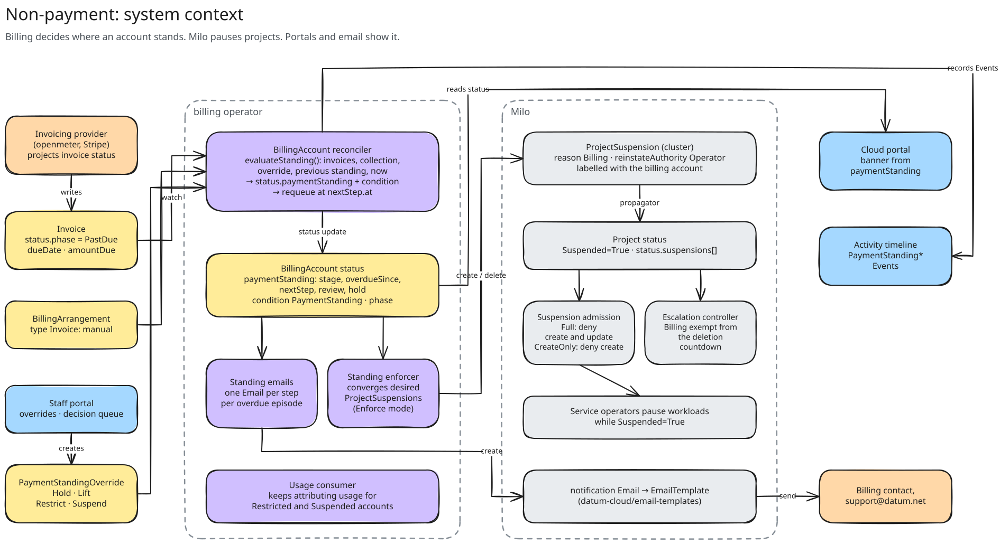
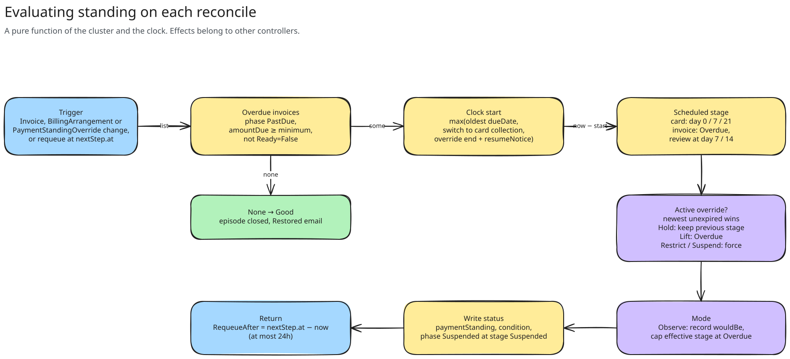
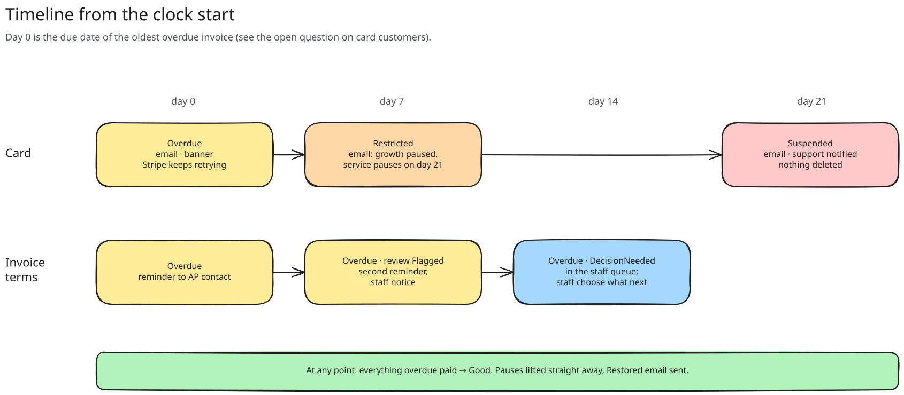
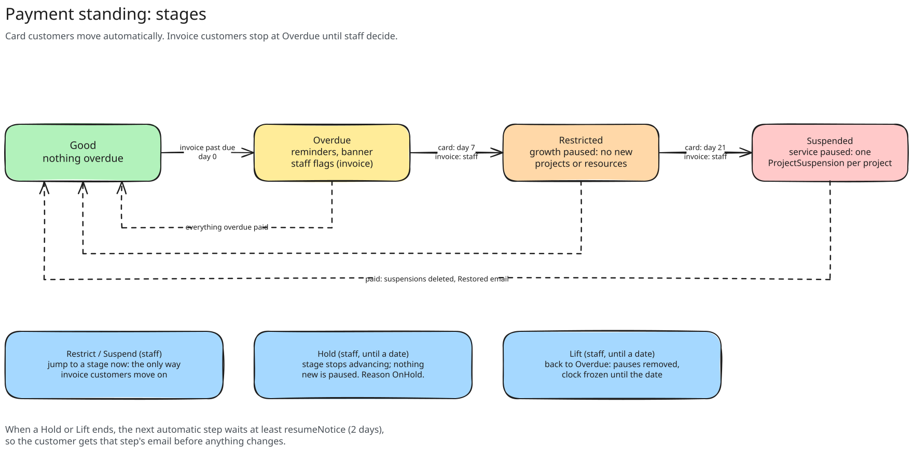
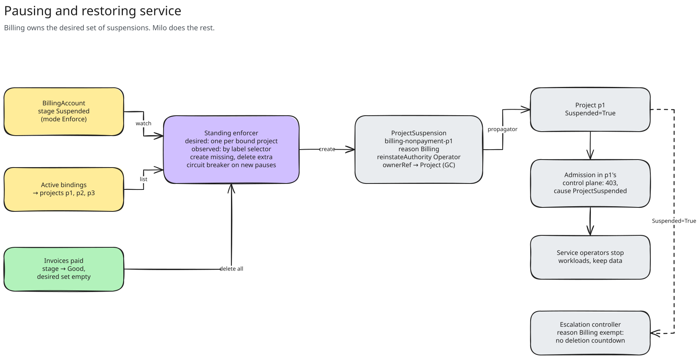

<!-- omit from toc -->
# What Happens When a Customer Doesn't Pay: Architecture

- [Summary](#summary)
- [Constraints](#constraints)
- [Architecture](#architecture)
- [API Changes](#api-changes)
  - [BillingAccount status](#billingaccount-status)
  - [PaymentStandingOverride](#paymentstandingoverride)
  - [Operator config](#operator-config)
- [Evaluating Standing](#evaluating-standing)
  - [Which invoices count](#which-invoices-count)
  - [The clock](#the-clock)
  - [Schedules](#schedules)
  - [Staff overrides](#staff-overrides)
  - [Observe and enforce](#observe-and-enforce)
  - [The evaluator](#the-evaluator)
- [Effects](#effects)
  - [Overdue](#overdue)
  - [Restricted: pausing growth](#restricted-pausing-growth)
  - [Suspended: pausing service](#suspended-pausing-service)
  - [Paying up](#paying-up)
- [Usage Keeps Flowing](#usage-keeps-flowing)
- [Emails](#emails)
- [Activity Timeline](#activity-timeline)
- [Portals](#portals)
- [Milo Changes](#milo-changes)
- [Security and Permissions](#security-and-permissions)
- [Rollout](#rollout)
- [Production Readiness](#production-readiness)
- [Testing](#testing)
- [Where the Design Stands on the Open Questions](#where-the-design-stands-on-the-open-questions)
- [Alternatives](#alternatives)
- [Work Plan](#work-plan)
- [Implementation History](#implementation-history)

## Summary

This is the technical design for
[What Happens When a Customer Doesn't Pay](../nonpayment-suspension.md),
which covers the product behaviour. It describes how billing works out
where each `BillingAccount` stands, how it pauses growth and service through
Milo, and how customers, staff and support find out.

In short:

- The `BillingAccount` reconciler gains a pure function, `evaluateStanding`,
  that turns the account's invoices, how it pays, any staff override and the
  clock into `status.paymentStanding` and a `PaymentStanding` condition. It
  requeues itself for the next step.
- A new **standing enforcer** controller makes Milo match that status. It
  creates one `ProjectSuspension` (reason `Billing`) for each project bound
  to a suspended account, and deletes them when the account is paid.
- A new **standing email** controller sends one Milo `Email` per step.
- Staff act through a new staff-only `PaymentStandingOverride` resource:
  `Hold`, `Lift`, `Restrict` or `Suspend`.
- Everything ships switched off. The first release runs in `Observe` mode:
  status, events and reminders, with no pauses.

Milo needs four changes first. The largest is that it currently deletes any
project suspended for longer than its retention window, whatever the reason.

## Constraints

These shape most of the design:

- **Billing never writes to a customer's resources directly.** It decides
  where an account stands; Milo's project suspension pauses the projects.
- **Paying must restore service without anyone acting.** Lifting is driven by
  the same reconcile that pauses, so it can't be forgotten.
- **Nothing billing does deletes anything.** Milo's escalation controller
  deletes projects suspended for longer than
  `--project-suspension-retention-window-days`, and nothing exempts any
  reason today. Billing must not create a suspension until Milo exempts
  `Billing`.
- **Customers can edit their own `BillingAccount` spec, labels and
  annotations.** Staff decisions can't live there.
- **Invoice data comes from the invoicing provider.** A provider bug that
  marks invoices `PastDue` would pause customers, so enforcement needs a
  circuit breaker.
- **Usage keeps flowing.** Workloads keep running while growth is paused,
  and storage is still used while service is paused. That usage must still be
  attributed and billed.
- **Milo's `ProjectSuspension` feature gate is Alpha and off by default.**
  It has to be on in an environment before billing can enforce there.

## Architecture



*System context. The editable sources for every diagram in this document are
the `.excalidraw` files in [`diagrams/`](./diagrams).*

| Component | Change | Responsibility |
| --- | --- | --- |
| **BillingAccount reconciler** (`internal/controller/billingaccount_controller.go`) | Extended | Evaluates standing on every reconcile and writes `status.paymentStanding`, the `PaymentStanding` condition and the phase. Records timeline events on transitions. Requeues for the next step. |
| **Standing enforcer** (new, `internal/controller/paymentstanding_enforcer.go`) | New | Converges Milo `ProjectSuspension`s with the account's stage. The only component that writes to Milo for this feature. |
| **Standing emails** (new, `internal/controller/paymentstanding_email_controller.go`) | New | Creates one Milo `Email` per step per overdue episode, in the same way as `PaymentTermsApplicationEmailReconciler`. |
| **PaymentStandingOverride** (new CRD) | New | Records staff decisions: hold, lift, restrict or suspend. Customers can't read or write it. |
| **BillingAccountBinding webhook** (`internal/validation/billingaccountbinding.go`) | Extended | Rejects new bindings to a Restricted or Suspended account, and moving a project off one. |
| **Usage consumer** (`internal/controller/consumer`) | Extended | Keeps attributing usage to Restricted and Suspended accounts. |
| **Milo** | Extended | Exempts `Billing` suspensions from deletion, adds a create-only suspension, and blocks new projects for restricted organizations. See [Milo Changes](#milo-changes). |

The evaluator only writes status. The enforcer and the email controller only
read that status. Each one can be tested, switched off and reasoned about on
its own, and the status is the single record of what billing has decided.

## API Changes

### BillingAccount status

A new `status.paymentStanding`, set by billing whenever the account has had
an overdue invoice, and a new condition.

```go
// PaymentStandingStage is how far the non-payment process has gone.
// +kubebuilder:validation:Enum=Good;Overdue;Restricted;Suspended
type PaymentStandingStage string

const (
	PaymentStandingGood       PaymentStandingStage = "Good"
	PaymentStandingOverdue    PaymentStandingStage = "Overdue"
	PaymentStandingRestricted PaymentStandingStage = "Restricted"
	PaymentStandingSuspended  PaymentStandingStage = "Suspended"
)

// PaymentCollection is how the account's invoices are collected.
// +kubebuilder:validation:Enum=Automatic;Manual
type PaymentCollection string

const (
	// PaymentCollectionAutomatic: charged to a card. Moves through the
	// stages on its own.
	PaymentCollectionAutomatic PaymentCollection = "Automatic"
	// PaymentCollectionManual: an Invoice BillingArrangement is active.
	// Never restricted or suspended without a staff override.
	PaymentCollectionManual PaymentCollection = "Manual"
)

// PaymentStandingReview flags a manually collected account for staff.
// +kubebuilder:validation:Enum=Flagged;DecisionNeeded
type PaymentStandingReview string

type BillingAccountPaymentStanding struct {
	// Stage is where the account stands now. Effects follow this field.
	Stage PaymentStandingStage `json:"stage"`

	// WouldBe is the stage the schedule calls for, before the operator's
	// mode caps it. Equal to Stage when enforcing. In Observe mode it
	// shows who would be paused, without pausing them.
	// +optional
	WouldBe PaymentStandingStage `json:"wouldBe,omitempty"`

	// Collection is how the account pays, which picks the schedule.
	Collection PaymentCollection `json:"collection"`

	// OverdueSince is when the clock started for the current overdue
	// episode. Unset when Good.
	// +optional
	OverdueSince *metav1.Time `json:"overdueSince,omitempty"`

	// OldestOverdueInvoice is the invoice that started the clock.
	// +optional
	OldestOverdueInvoice *LocalInvoiceRef `json:"oldestOverdueInvoice,omitempty"`

	// AmountOverdue is the sum of amountDue over every overdue invoice,
	// as a decimal string in the account's currency.
	// +optional
	AmountOverdue string `json:"amountOverdue,omitempty"`

	// Review is set for manually collected accounts that need staff.
	// +optional
	Review PaymentStandingReview `json:"review,omitempty"`

	// NextStep is the next automatic change and when it happens. Unset
	// when nothing will change on its own.
	// +optional
	NextStep *PaymentStandingStep `json:"nextStep,omitempty"`

	// Hold is set while a staff Hold or Lift is in effect. Only the
	// action and end date are copied: the reason stays on the override.
	// +optional
	Hold *PaymentStandingHold `json:"hold,omitempty"`

	// LastTransitionTime is when Stage last changed.
	LastTransitionTime metav1.Time `json:"lastTransitionTime"`
}

type PaymentStandingStep struct {
	Stage PaymentStandingStage `json:"stage"`
	At    metav1.Time          `json:"at"`
}

type PaymentStandingHold struct {
	Action PaymentStandingAction `json:"action"` // Hold or Lift
	Until  *metav1.Time          `json:"until,omitempty"`
}
```

The condition follows the existing `PaymentReady` and `InvoicingReady`
pattern, so Milo and the portals can gate on one signal:

```go
// BillingAccountConditionPaymentStanding is True while nothing is overdue.
//
// Reasons:
//   - Good — nothing overdue (True)
//   - Overdue — an invoice is overdue; nothing is paused (False)
//   - OnHold — overdue, and staff have paused the process (False)
//   - Restricted — growth is paused (False)
//   - Suspended — service is paused (False)
const BillingAccountConditionPaymentStanding = "PaymentStanding"
```

**Phase.** `determinePhase` treats `Suspended` as "managed externally"
today, and nothing sets it. It becomes derived: the phase is `Suspended`
exactly when `paymentStanding.stage` is `Suspended`, and `Ready` otherwise
(`Archived` is unchanged). The binding webhook already rejects bindings to
accounts that aren't `Ready`, so a suspended account can't gain projects.

### PaymentStandingOverride

A staff decision is its own resource, in the same way
`BillingArrangementDecline` keeps reviewers' notes away from customers.

```go
// +kubebuilder:validation:Enum=Hold;Lift;Restrict;Suspend
type PaymentStandingAction string

// +kubebuilder:validation:XValidation:rule="!(self.action in ['Hold', 'Lift']) || has(self.until)",message="until is required for Hold and Lift"
type PaymentStandingOverrideSpec struct {
	// BillingAccountRef is the account in the same namespace. Immutable.
	// +kubebuilder:validation:XValidation:rule="self == oldSelf",message="billingAccountRef is immutable"
	BillingAccountRef BillingAccountRef `json:"billingAccountRef"`

	// Action is what staff decided. Immutable.
	//   Hold: stop advancing. Nothing new is paused; existing pauses stay.
	//   Lift: drop back to Overdue and stop advancing. Pauses are removed.
	//   Restrict, Suspend: go to that stage now.
	// +kubebuilder:validation:XValidation:rule="self == oldSelf",message="action is immutable"
	Action PaymentStandingAction `json:"action"`

	// Until is when the override stops applying. Staff end it early by
	// setting Until to now or by deleting the override.
	// +optional
	Until *metav1.Time `json:"until,omitempty"`

	// Reason records why. Internal: never shown to customers.
	// +kubebuilder:validation:MinLength=1
	// +kubebuilder:validation:MaxLength=2000
	Reason string `json:"reason"`
}

// +kubebuilder:validation:Enum=Active;Expired;Superseded;Resolved
type PaymentStandingOverridePhase string
```

The override's own reconcile sets `status.phase`:

- `Active` while it's the newest unexpired override for its account.
- `Superseded` once staff create a newer one.
- `Expired` after `until`.
- `Resolved` when the account returns to `Good`. Paying always wins: a
  `Suspend` override doesn't keep a paid account suspended. Staff who need to
  suspend a project for another reason use a Milo `ProjectSuspension` with
  that reason directly.

The resource carries `discovery.miloapis.com/parent-contexts=Organization`,
like the other organization-scoped billing resources. Only the new staff role
can read or write it ([Security and Permissions](#security-and-permissions)).

### Operator config

A new block in `BillingOperator`, next to `PaymentTermsApplicationEmails`:

```go
type PaymentStandingConfig struct {
	// Mode is Off, Observe or Enforce. Defaults to Off.
	//   Off:     no standing is computed; billing suspensions are removed.
	//   Observe: standing, events and emails, but Stage is capped at
	//            Overdue. WouldBe shows what Enforce would do.
	//   Enforce: Stage is capped at MaxStage.
	Mode PaymentStandingMode `json:"mode,omitempty"`

	// MaxStage is the furthest stage Enforce applies: Restricted or
	// Suspended. Defaults to Restricted.
	MaxStage PaymentStandingStage `json:"maxStage,omitempty"`

	// Automatic is the card schedule, from the clock start.
	// Defaults: restrictAfter 168h (7 days), suspendAfter 504h (21 days).
	Automatic AutomaticSchedule `json:"automatic"`

	// Manual is the invoice terms schedule.
	// Defaults: flagAfter 168h (7 days), decisionAfter 336h (14 days).
	Manual ManualSchedule `json:"manual"`

	// AutomaticClockStart is DueDate or FirstPaymentFailure. See "The
	// clock". Defaults to DueDate.
	AutomaticClockStart ClockStart `json:"automaticClockStart,omitempty"`

	// ResumeNotice is the least time between a Hold or Lift ending and
	// the next automatic step. Defaults to 48h.
	ResumeNotice metav1.Duration `json:"resumeNotice,omitempty"`

	// MinimumAmountDue ignores invoices owing less than this, as a
	// decimal string. Defaults to "0.50".
	MinimumAmountDue string `json:"minimumAmountDue,omitempty"`

	// MaxNewSuspensionsPerHour trips the enforcer's circuit breaker.
	// Defaults to 10 accounts.
	MaxNewSuspensionsPerHour int `json:"maxNewSuspensionsPerHour,omitempty"`

	// Emails configures the standing emails. Same shape as
	// PaymentTermsApplicationEmailsConfig.
	Emails PaymentStandingEmailsConfig `json:"emails"`
}
```

Every timing lives in config, not code, so question 1 in the proposal can be
answered by changing a number. Shorter values in the dev overlay make the
end-to-end tests run in minutes.

## Evaluating Standing



*Every reconcile computes standing from scratch. The previous status only
matters for Hold, which keeps whatever stage the account had.*

### Which invoices count

An invoice is **overdue** when all of these hold:

- `status.phase` is `PastDue`. For automatic collection with
  `AutomaticClockStart: FirstPaymentFailure`, an `Open` invoice with
  `status.paymentFailedAt` set also counts.
- `status.amountDue` is at least `MinimumAmountDue`. Free accounts and
  accounts paid by credits have invoices that end up `Paid` or `$0`, so they
  never count (question 6).
- It doesn't have `Ready=False`. A provider that reports `CurrencyMismatch`
  hasn't produced a trustworthy invoice.

`Void` invoices never count.

This differs from `InvoicingReady`, on purpose. `InvoicingReady` looks only
at the **newest** Open, Paid or PastDue invoice, so a new `Open` invoice on
the 1st makes an account with last month's invoice still unpaid look
`Current`. Standing looks at **every** invoice, and the clock follows the
oldest. `InvoicingReady` stays as it is for its existing readers.

The appendix of the proposal also excludes "old ones nothing updates any
more". The provider keeps projecting an invoice until it's paid or voided, so
the design doesn't guess at staleness. An invoice that really is abandoned
should be voided by finance, which removes it from the count.

### The clock

The clock for an overdue episode starts at the latest of:

1. **The oldest overdue invoice's start.** That's its `status.dueDate`. With
   `FirstPaymentFailure` on a card account, it's `status.paymentFailedAt`
   when that's earlier.
2. **When the account moved to card collection.** If staff end an account's
   invoice terms, its invoices may already be 30 days overdue. Without this,
   it would jump straight to `Suspended`. The time comes from
   `accountArrangements.lastEnded.Spec.EndsAt`, which the reconciler already
   loads for `PaymentReady`.
3. **The end of the last Hold or Lift, plus `ResumeNotice`.** It's measured
   from the next step, not the start. See [Staff overrides](#staff-overrides).

`paymentFailedAt` is a new optional `Invoice` status field. The provider sets
it on the first failed charge attempt and never clears it. The provider
already sees that failure; it records `InvoicePaymentFailed` events for the
timeline. It's needed only if the team answers question 2 with "from the
first failure".

An episode ends when nothing is overdue. The next overdue invoice starts a
new episode with a new clock, so a customer who pays late every month starts
from reminders each time.

### Schedules



```go
func scheduled(collection PaymentCollection, start, now time.Time, cfg PaymentStandingConfig) (PaymentStandingStage, PaymentStandingReview, *step) {
	elapsed := now.Sub(start)
	switch collection {
	case PaymentCollectionAutomatic:
		switch {
		case elapsed >= cfg.Automatic.SuspendAfter.Duration:
			return PaymentStandingSuspended, "", nil
		case elapsed >= cfg.Automatic.RestrictAfter.Duration:
			return PaymentStandingRestricted, "", at(PaymentStandingSuspended, start.Add(cfg.Automatic.SuspendAfter.Duration))
		default:
			return PaymentStandingOverdue, "", at(PaymentStandingRestricted, start.Add(cfg.Automatic.RestrictAfter.Duration))
		}
	default: // Manual: never past Overdue on a schedule.
		switch {
		case elapsed >= cfg.Manual.DecisionAfter.Duration:
			return PaymentStandingOverdue, ReviewDecisionNeeded, nil
		case elapsed >= cfg.Manual.FlagAfter.Duration:
			return PaymentStandingOverdue, ReviewFlagged, nil
		default:
			return PaymentStandingOverdue, "", nil
		}
	}
}
```

Manual accounts never get a `nextStep`. The review flags have their own
requeue, but they aren't a change the customer sees.

### Staff overrides



The newest unexpired override wins:

| Action | Stage | Next step |
| --- | --- | --- |
| `Hold` | The previous `status.paymentStanding.stage`, at least `Overdue`. | None until `until`. |
| `Lift` | `Overdue`. The enforcer removes any pauses. | None until `until`. |
| `Restrict` | `Restricted`. | Automatic accounts carry on to `Suspended` on schedule. Manual accounts stay. |
| `Suspend` | `Suspended`. | None. |

When a `Hold` or `Lift` ends, its `until` plus `ResumeNotice` becomes a floor
for the next step. Take a card customer held from day 5 to day 30. They don't
go straight to `Suspended` on day 30. They're `Restricted` at day 32, which
is when the "growth paused" email goes out, and `Suspended` 14 days after
that. That's the same gap as the normal schedule. In code, the floor shifts
the remaining schedule rather than just delaying the next step:

```go
// shiftAfterOverride moves the schedule so each remaining step keeps its
// usual gap, starting no sooner than the floor.
func shiftAfterOverride(start time.Time, floor time.Time, next *step, cfg PaymentStandingConfig) time.Time {
	if next == nil || !next.At.Before(floor) {
		return start
	}
	return start.Add(floor.Sub(next.At)) // the new clock start
}
```

The shifted start is what's written to `overdueSince`. It's not re-derived on
the next reconcile, because the override that caused it may have been
deleted. That's the one field the evaluator reads back from its own status.

### Observe and enforce

The evaluator always computes the scheduled stage, after overrides, into
`WouldBe`. `Stage` is then capped:

- `Observe`: at `Overdue`.
- `Enforce`: at `MaxStage`.

The enforcer and the email controller only read `Stage`, so they need no
mode checks of their own. `WouldBe` is the dry run. During the observe phase,
`kubectl get billingaccounts -A -o json | jq` (or the staff portal) lists who
would be restricted and suspended, and when.

### The evaluator

The function is pure, so the tests can call it with a table of invoices and
a fixed clock. The reconciler already threads a clock through `nowFrom(r.now)`.

```go
type standingInput struct {
	Invoices         []billingv1alpha1.Invoice
	Collection       billingv1alpha1.PaymentCollection
	CollectionSince  *time.Time // when automatic collection began, if recent
	Overrides        []billingv1alpha1.PaymentStandingOverride
	Previous         *billingv1alpha1.BillingAccountPaymentStanding
	Now              time.Time
	Config           config.PaymentStandingConfig
}

func evaluateStanding(in standingInput) *billingv1alpha1.BillingAccountPaymentStanding {
	overdue := overdueInvoices(in.Invoices, in.Collection, in.Config)
	if len(overdue) == 0 {
		return good(in.Previous, in.Now) // nil if it was never anything else
	}

	start := clockStart(overdue, in.Collection, in.CollectionSince, in.Previous, in.Config)
	stage, review, next := scheduled(in.Collection, start, in.Now, in.Config)

	override := activeOverride(in.Overrides, in.Now)
	if override == nil {
		if floor, ok := lastOverrideFloor(in.Overrides, in.Config); ok {
			start = shiftAfterOverride(start, floor, next, in.Config)
			stage, review, next = scheduled(in.Collection, start, in.Now, in.Config)
		}
	}
	stage, next, hold := applyOverride(stage, next, override, in.Previous)

	out := &billingv1alpha1.BillingAccountPaymentStanding{
		WouldBe:              stage,
		Stage:                capStage(stage, in.Config),
		Collection:           in.Collection,
		OverdueSince:         &metav1.Time{Time: start},
		OldestOverdueInvoice: &billingv1alpha1.LocalInvoiceRef{Name: overdue[0].Name},
		AmountOverdue:        sumAmountDue(overdue),
		Review:               review,
		NextStep:             capStep(next, in.Config),
		Hold:                 hold,
	}
	out.LastTransitionTime = transitionTime(in.Previous, out.Stage, in.Now)
	return out
}
```

In `Reconcile` it runs after `reconcilePaymentReadyCondition`, which has
already loaded the arrangements. It joins the existing requeue:

```go
standingBefore := account.Status.PaymentStanding.DeepCopy()
standing := evaluateStanding(r.standingInput(ctx, &account, invoices, arrangements, now))
account.Status.PaymentStanding = standing
setPaymentStandingCondition(&account, standing)
account.Status.Phase = phaseFor(&account, standing)
// ... existing Status().Update ...
recordStandingTransition(r.recorder, &account, standingBefore, standing)

return requeueAt(earliest(nextBoundary, standing.NextStep.At, standing.Hold.Until, reviewBoundary), now), nil
```

The invoice list is the one `reconcileInvoicingCondition` already makes,
through the `InvoiceBillingAccountRefField` index, so standing adds one
`PaymentStandingOverride` list per reconcile. The reconciler gains a watch on
`PaymentStandingOverride`, mapped by `spec.billingAccountRef`. A 24h cap on
`RequeueAfter` guarantees every account is evaluated at least daily, even if
a watch event is lost.

## Effects

### Overdue

Overdue does nothing to the customer's resources:

- The condition and status change.
- A timeline event is recorded.
- The email controller sends the first email.
- The cloud portal shows the banner.

### Restricted: pausing growth

Paused growth has two parts.

**No new projects.** The binding webhook rejects new bindings to a
Restricted or Suspended account. It already rejects accounts that aren't
`Ready`; the check widens to the condition:

```go
if reason := standingReason(account); reason == "Restricted" || reason == "Suspended" {
	return field.Forbidden(field.NewPath("spec", "billingAccountRef"),
		fmt.Sprintf("billing account %q has an overdue invoice; pay it to add projects", account.Name))
}
```

The webhook also rejects a binding that would move a project **off** a
Restricted or Suspended account. Otherwise a customer could add a new card
on a new account and rebind every project to escape the pause, leaving the
debt behind. Staff can still move projects with a `Lift`.

`ProjectBillingBinder.accountForNewProjects` already skips accounts that
aren't `Ready`. It also needs to skip Restricted accounts, so it doesn't keep
retrying a binding the webhook will refuse. Milo then needs to stop the
project being created at all; see [Milo Changes](#milo-changes).

**No new resources inside existing projects.** The proposal leaves this open
(question 3). The design recommends a create-only mode of Milo's
`ProjectSuspension`:

```go
// New, immutable, defaults to Full.
// +kubebuilder:validation:Enum=Full;CreateOnly
Enforcement ProjectSuspensionEnforcement `json:"enforcement,omitempty"`
```

| | `Full` (today) | `CreateOnly` (new) |
| --- | --- | --- |
| Admission | Denies create and update | Denies create by users. Platform controllers are exempt, so a restart can still create its pod. |
| Project condition | `Suspended=True` | `Restricted=True`. `Suspended` stays `False`, so services keep workloads running. |
| Escalation controller | Counts down to deletion | Ignores it |
| 403 cause | `ProjectSuspended` | `ProjectRestricted` |

At `Restricted`, the enforcer creates a `CreateOnly` suspension named
`billing-nonpayment-restrict-<project>`. At `Suspended` it creates the
`Full` one, `billing-nonpayment-<project>`, and only then deletes the
`CreateOnly` one, so there's no gap.

What this doesn't catch is a **scale-up through an update**, such as raising
`replicas`. Only per-resource knowledge can tell a scale-up from any other
update, and Milo's quota system is the place that has it. The design accepts
"no new resources" for the first enforcing release. It leaves scale-ups to a
later quota-based change; see [Alternatives](#alternatives).

### Suspended: pausing service



The enforcer is a level-triggered controller over `BillingAccount`. It
computes the desired set of suspensions from status and bindings, lists the
existing ones by label, and fixes the difference.

```go
const (
	labelManagedBy        = "app.kubernetes.io/managed-by" // "billing"
	labelAccountNamespace = "billing.miloapis.com/billing-account-namespace"
	labelAccountName      = "billing.miloapis.com/billing-account-name"
)

func (r *PaymentStandingEnforcer) Reconcile(ctx context.Context, req reconcile.Request) (ctrl.Result, error) {
	var account billingv1alpha1.BillingAccount
	err := r.client.Get(ctx, req.NamespacedName, &account)
	if client.IgnoreNotFound(err) != nil {
		return ctrl.Result{}, err
	}

	desired := map[string]resourcemanagerv1alpha1.ProjectSuspension{}
	if err == nil { // a deleted account wants nothing, so its leftovers go
		projects, err := r.boundProjects(ctx, &account) // Active bindings only
		if err != nil {
			return ctrl.Result{}, err
		}
		for _, project := range projects {
			for _, s := range suspensionsFor(&account, project) { // none, CreateOnly or Full
				desired[s.Name] = s
			}
		}
	}

	var existing resourcemanagerv1alpha1.ProjectSuspensionList
	if err := r.milo.List(ctx, &existing, client.MatchingLabels{
		labelManagedBy:        "billing",
		labelAccountNamespace: req.Namespace,
		labelAccountName:      req.Name,
	}); err != nil {
		return ctrl.Result{}, err
	}

	// Create before delete, so moving from CreateOnly to Full never
	// leaves a project unrestricted.
	for name, s := range desired {
		if hasSuspension(existing.Items, name) {
			continue
		}
		if !r.breaker.Allow(req.NamespacedName) {
			r.recordBreakerOpen(&account)
			return ctrl.Result{RequeueAfter: time.Hour}, nil
		}
		if err := r.milo.Create(ctx, &s); client.IgnoreAlreadyExists(err) != nil {
			return ctrl.Result{}, err
		}
	}
	for i := range existing.Items {
		if _, ok := desired[existing.Items[i].Name]; !ok {
			if err := r.milo.Delete(ctx, &existing.Items[i]); client.IgnoreNotFound(err) != nil {
				return ctrl.Result{}, err
			}
		}
	}
	return ctrl.Result{}, nil
}
```

The suspension billing creates:

```yaml
apiVersion: resourcemanager.miloapis.com/v1alpha1
kind: ProjectSuspension
metadata:
  name: billing-nonpayment-p1
  labels:
    app.kubernetes.io/managed-by: billing
    billing.miloapis.com/billing-account-namespace: organization-acme
    billing.miloapis.com/billing-account-name: acme-billing
spec:
  projectRef:
    name: p1
  reason: Billing
  reinstateAuthority: Operator
  enforcement: Full
  description: >-
    Paused for non-payment: invoice acme-billing-2026-10 is 21 days overdue.
    Lifted automatically when the account's overdue invoices are paid.
```

Some details:

- **Cluster-scoped, in Milo's root control plane.** `ProjectSuspension` has
  no parent context. Billing's existing Milo client (`KubeconfigPath`) can
  write it once billing's service account has
  `resourcemanager-projectsuspensions-editor` at the platform level.
- **Garbage collection.** Milo's mutating webhook adds an ownerReference to
  the Project, so deleting a project removes its suspension. Billing doesn't
  need to handle that.
- **Watches.** The enforcer watches `BillingAccount` (status changes),
  `BillingAccountBinding` (a project bound to a suspended account), and
  `ProjectSuspension` filtered by `labelManagedBy`. That last watch lets it
  put back a suspension someone deleted by hand. Staff who want to lift a
  pause use a `Lift` override, not `kubectl delete`.
- **Description.** It's the only free text Milo shows. It names the invoice
  and says how to fix it; it never includes an amount.
- **`reinstateAuthority`** is set to `Operator`, but Milo doesn't enforce it
  today. Nothing stops a project owner with suspension permissions from
  deleting it. Customers have no such permission, and the enforcer would put
  it back anyway.
- **Multi-team accounts** (question 4). Every project bound to the account
  is paused, whichever team owns it. That follows from billing by account.
  The emails go to the account's billing contact, and the portal banner shows
  in every affected project.

### Paying up

When the provider marks the last overdue invoice `Paid`:

1. The `Invoice` watch requeues the account.
2. The evaluator finds nothing overdue and sets stage `Good`. It closes the
   episode and marks any active override `Resolved`.
3. The enforcer's desired set is empty, so it deletes every billing
   suspension for the account. Milo's propagator clears `Suspended`, the
   escalation controller cancels any countdown, and services restart
   workloads.
4. The email controller sends the "restored" email. The timeline gets
   `PaymentStandingRestored`.

This is typically seconds after the provider projects the payment. The
customer never needs to contact support.

## Usage Keeps Flowing

The usage consumer only attributes usage to accounts in the `Ready` phase
(`BillingAccountCache.GetReady`). Usage for anything else is quarantined.
Once the phase becomes `Suspended`, usage from workloads still running during
the transition, and from storage kept while paused, would stop being billed.

The cache's index changes from "Ready" to "billable":

```go
func billable(account *billingv1alpha1.BillingAccount) bool {
	switch account.Status.Phase {
	case billingv1alpha1.BillingAccountPhaseReady,
		billingv1alpha1.BillingAccountPhaseSuspended:
		return true
	}
	return false
}
```

`GetReady` becomes `GetBillable`. The `usagereport` client's preference for a
`Ready` account when none is named is unchanged; that only picks what to show.
This change must ship before any account can reach `Suspended`.

## Emails

The email controller watches `BillingAccount` and creates Milo `Email`s in
`milo-system`, in the same way as `PaymentTermsApplicationEmailReconciler`.
It uses deterministic names, so retries and requeues send each email once.

```go
// payment-standing-<account uid>-<episode>-<step>, where episode is the
// Unix time of overdueSince when the episode began.
name := fmt.Sprintf("payment-standing-%s-%d-%s", account.UID, episodeStart.Unix(), step)
```

| Step | Sent when | To | Template |
| --- | --- | --- | --- |
| `overdue` | The episode starts | Billing contact; for manual collection, `invoiceEmails[0]` too | `paymentoverdue` |
| `reminder` | Manual, day 7 | Same | `paymentoverduereminder` |
| `growth-paused` | Stage becomes `Restricted` | Billing contact | `paymentgrowthpaused` |
| `service-paused` | Stage becomes `Suspended` | Billing contact | `paymentservicepaused` |
| `restored` | Back to `Good` from any stage | Billing contact | `paymentrestored` |
| `staff-flagged`, `staff-decision`, `staff-suspended` | Manual day 7, manual day 14, any account `Suspended` | `support@datum.net` | `paymentstandingstaffnotice` |

Template names follow the existing convention
(`emailtemplates.notification.miloapis.com-<name>emailtemplate`) and live in
`datum-cloud/email-templates`. The customer emails carry:

- `OrganizationName`
- `InvoiceNumber`
- `AmountOverdue`
- `NextStepDate`
- `PayUrl`, which points at the invoice in the cloud portal

The staff notice links to the account in the staff portal.

Recipients are raw addresses (`EmailRecipient.EmailAddress`), since the
billing contact isn't necessarily a Milo user. Question 5 asks whether
project owners should also be told. That's an extra `cc` list built from the
organization's owners. The controller can add it without changing anything
else.

**First rollout.** When emails are switched on, some accounts will already
have been overdue for months. Like `MaxEventAge` for payment terms emails,
the controller skips a step whose transition is older than `MaxEventAge`
(72h). It also skips the `overdue` email for any episode that began before
emails were enabled. Support gets a one-off list of those accounts instead
of every customer getting an email on the same morning.

Stripe's own reminders and dunning emails carry on. The design doesn't try
to merge them.

## Activity Timeline

The evaluator records an event on each transition, in the same way as
`recordInvoicingTransition`. These follow the
[billing activity](../billing-activity.md) event contract: reasons in
`api/v1alpha1/events.go`, detail in `event.billing.miloapis.com/`
annotations, and org scope annotations on customer-visible events.

| Reason | Visible to | Annotations |
| --- | --- | --- |
| `PaymentStandingOverdue` | Organization | invoice, amount, currency, next step and date |
| `PaymentStandingRestricted` | Organization | invoice, next step and date |
| `PaymentStandingSuspended` | Organization | invoice, project count |
| `PaymentStandingRestored` | Organization | — |
| `PaymentStandingOnHold` | Organization | until |
| `PaymentStandingReviewNeeded` | Staff only | review (`Flagged` or `DecisionNeeded`) |

The audit log already records staff creating `PaymentStandingOverride`s
(who, when). A new `ActivityPolicy` renders those for the staff timeline,
including the reason, which only staff can see.

## Portals

**Cloud portal**

- **Banner.** Shown while `PaymentStanding` is `False`, with the copy keyed by
  reason and the date from `nextStep.at`. It links to the invoice named in
  `oldestOverdueInvoice`. The banner shows on the billing account and on
  every project bound to it.
- **Errors.** A 403 with cause `ProjectRestricted` or `ProjectSuspended`
  becomes "This project's billing account has an overdue invoice", with the
  same link. The same goes for a binding or project create rejected for
  standing.

**Staff portal**

- **Billing account.** Shows the stage, `wouldBe` when it differs, the clock
  start, the next step, and the active override.
- **Override actions.** Hold, lift, restrict and suspend actions create a
  `PaymentStandingOverride`, with a required reason.
- **Decision queue.** Lists accounts where `paymentStanding.review` is
  `DecisionNeeded`, oldest first. It lists billing accounts across
  organizations and filters client-side, as the fleet overview already does.
  If that gets slow, a CRD selectable field on `status.paymentStanding.review`
  lets it filter on the server.

## Milo Changes

These are prerequisites. Billing can't enforce until they're released.

| # | Change | Needed before |
| --- | --- | --- |
| 1 | **Exempt `Billing` from deletion.** A flag like `--project-suspension-deletion-exempt-reasons=Billing` (default empty). Exempt suspensions don't start a countdown or send deletion warnings. Today the only per-reason control, `--project-suspension-warning-excluded-reasons`, suppresses the warnings and still deletes. Note that the retention window deployed is **90 days**, not the 30-day code default the proposal mentions. | Suspended |
| 2 | **Turn on the `ProjectSuspension` feature gate** in staging and production (Alpha, off by default). Until it's on, Milo's webhook rejects every create. | Restricted |
| 3 | **`enforcement: CreateOnly`** on `ProjectSuspension`, with a `Restricted` project condition, a `ProjectRestricted` 403 cause, an exemption for platform controllers, and the escalation controller ignoring it. | Restricted |
| 4 | **Block new projects for restricted organizations.** The Project validating webhook rejects a create when the account new projects would be billed to (the same rule as billing's `accountForNewProjects`) has `PaymentStanding` reason `Restricted` or `Suspended`. Milo already reads billing account conditions in `organization_onboarding.go`. | Restricted |

Services also need to honour `Suspended=True` by stopping workloads. That's
part of Milo's suspension design, not billing's, but enforcement shouldn't
start until each service that runs customer workloads has confirmed it does.

## Security and Permissions

| Who | Can | Through |
| --- | --- | --- |
| Customers (Billing Admin, Billing Viewer) | Read `status.paymentStanding` and the condition | Existing `billingaccounts.get` |
| Customers | Not read or write `PaymentStandingOverride` | Not included in customer roles |
| Staff | Create, read and end overrides | New `billing.miloapis.com-payment-standing-admin` role (and `-viewer`), bound to staff only, like `billing-arrangement-admin` |
| Billing operator | Write `PaymentStandingOverride` status, create and delete `ProjectSuspension`s | Controller RBAC, plus a Milo PolicyBinding for `resourcemanager-projectsuspensions-editor` in infra |

Other points:

- **Customers can't change their standing.** It lives in status, which only
  billing writes. Staff decisions live on a resource customers can't touch.
  The labels billing relies on are on `ProjectSuspension`s, which customers
  can't write.
- **Overrides are internal.** The override's reason is never copied to the
  account. The account shows only the action and its end date.
- **Ownership is narrow.** The enforcer only lists and deletes suspensions
  labelled `managed-by: billing`. It can't lift a `Fraud` or `Abuse`
  suspension, even on a paid account.

## Rollout

| Phase | Config | What happens | Exit criteria |
| --- | --- | --- | --- |
| 0. Prerequisites | — | Usage consumer attributes `Suspended` accounts. Milo changes 1–4 released. | Released in both environments. |
| 1. Observe | `mode: Observe`, emails off | Status, condition, events, overrides and the staff portal. No emails, no pauses. | Two invoice cycles. Staff review `wouldBe` for every overdue account and agree with it. No account flips wrongly. |
| 2. Reminders | `mode: Observe`, emails on | Overdue emails, reminders, staff notices and the portal banner. | Support is happy with the volume and wording. |
| 3. Pause growth | `mode: Enforce`, `maxStage: Restricted` | Card accounts are restricted at day 7. | No wrongful restrictions over one cycle. The breaker hasn't tripped on real data. |
| 4. Pause service | `maxStage: Suspended` | Card accounts are suspended at day 21. | — |

The project auto-binding rollout used the same pattern: compute in
production, compare with what staff expect, and only then act.
Staging gets each phase first. Staging's payg offer discounts usage 100%, so
staging accounts rarely owe anything. Tests there use a dedicated account
with a non-discounted offer.

## Production Readiness

**Metrics**

- `billing_payment_standing_accounts{stage, would_be, collection}` (gauge)
- `billing_payment_standing_transitions_total{from, to, collection, cause}`,
  where cause is `schedule`, `override` or `paid`
- `billing_payment_standing_managed_suspensions{enforcement}` (gauge)
- `billing_payment_standing_breaker_open` (gauge)
- `billing_payment_standing_restore_seconds` (histogram): from an invoice
  being `Paid` to its last suspension being deleted

**Alerts**

- The breaker is open.
- Any account has been `Suspended` for over 5 minutes with fewer managed
  suspensions than bound projects, or `Good` with any.
- The p99 of `restore_seconds` is over 10 minutes.
- Enforcer reconcile errors are sustained.

**Circuit breaker.** A provider bug or a bad import could mark many invoices
`PastDue` at once. The enforcer counts accounts it newly suspends or
restricts in a rolling hour. Past `MaxNewSuspensionsPerHour`, it stops
creating suspensions. It keeps deleting them, since restoring is always safe.
It also records a staff-only event and fires the alert. A person resets it by
restarting the operator or raising the limit.

**Kill switch.** `mode: Observe` caps every stage at `Overdue`, so the
enforcer deletes every billing suspension and service comes back everywhere.
That's deliberate: switching off must never leave customers paused. `mode:
Off` also stops evaluation, and the enforcer still removes any suspensions
it finds.

**Failure modes**

| Failure | Effect | Mitigation |
| --- | --- | --- |
| Billing operator down | Nothing advances, and nothing is lifted. A customer who pays stays paused. | Restore alert. Leader election and the PDB already exist. Staff can delete suspensions by hand while it's down; the enforcer only puts back what status still calls for. |
| Provider stops projecting payments | Paid customers look overdue and advance. | Breaker. The `Ready=False` exclusion. The restore alert catches paid-but-paused. |
| Milo admission cache lag | Writes are blocked or allowed a few seconds late. | Acceptable. |
| Clock skew | — | All times come from the operator's clock and the API server's timestamps. Steps are days apart. |

## Testing

- **Unit.** A table test for `evaluateStanding` covering:
  - each collection mode
  - each override, including an override ending
  - collection switching from invoice to card
  - several overdue invoices (oldest wins)
  - a newer `Open` invoice not masking an older `PastDue` one
  - amounts under the minimum
  - `Observe` capping
  - transition times

  A table test for `scheduled`. Tests for the binding webhook's new
  rejections, and for the usage cache's `billable`.
- **envtest.** The enforcer against Milo's `ProjectSuspension` CRD (from the
  `go.miloapis.com/milo` module billing already imports):
  - create on `Suspended`
  - `CreateOnly` to `Full` with no gap
  - delete on `Good`
  - recreate after a manual delete
  - clean up after the account is deleted
  - breaker behaviour
- **Email controller.** The same shape as
  `paymentterms_application_email_envtest_test.go`: one `Email` per step,
  nothing re-sent on requeue, and old transitions skipped.
- **Chainsaw e2e.** The dev overlay sets `restrictAfter: 1m` and
  `suspendAfter: 2m`. A test creates an account, a bound project and a
  `PastDue` invoice with a past due date. It asserts each stage, the
  suspension and the 403, then pays the invoice and asserts everything is
  lifted.

## Where the Design Stands on the Open Questions

| Proposal question | Design |
| --- | --- |
| 1. Timings | All in config. Changing them is a deploy, not a code change. |
| 2. Card clock start | Both supported (`AutomaticClockStart`). `FirstPaymentFailure` needs `Invoice.status.paymentFailedAt` from the provider. With `DueDate`, a card invoice that's due 30 days after issue and fails on day 0 pauses service about 51 days after the first failure. |
| 3. Pausing growth | Recommends Milo `enforcement: CreateOnly` plus billing refusing new bindings. Scale-ups by update aren't caught in the first release. |
| 4. Multi-team accounts | Every bound project is paused. Emails go to the billing contact; the banner shows in each project. |
| 5. Who gets emails | Billing contact (and the AP address for invoice customers). Owners can be added as `cc` later. |
| 6. Free and credit-funded accounts | Never affected: their invoices are `Paid` or below `MinimumAmountDue`. Covered by unit tests. |

## Alternatives

**A separate `PaymentStanding` resource per account.** It would keep
`BillingAccount` status smaller. But the portals and Milo already read
`BillingAccount`, and every reader would need a second lookup. The status is
the natural place, next to `PaymentReady` and `InvoicingReady`.

**Staff decisions on the `BillingAccount`** (annotations or spec). Customers
can edit both, so a customer could lift their own pause. Rejected.

**Pausing growth through quota.** Capping each project's `AllowanceBucket`s
at what they've allocated would catch scale-ups as well as creates, but only
for resource types registered with quota. It needs grants written and
removed per project per resource type, and there's no "cap at usage" in
Milo's quota today. It's the better long-term answer. It's too much to need
before the first enforcing release.

**Billing blocks writes with its own webhook.** It would duplicate Milo's
admission plugin, and every service's API would need billing's webhook.
Milo's suspension is already wired into every project control plane.
Rejected, as in the proposal.

**Timers as CronJobs or a scheduler.** `RequeueAfter` keeps the timer next
to the state that sets it, survives restarts (the next reconcile recomputes
it), and is how arrangements already flip `PaymentReady` on time. A periodic
resync (the 24h cap) covers anything missed.

## Work Plan

| Repo | Change | Depends on |
| --- | --- | --- |
| billing | API types, CRD, config, IAM roles and the `paymentFailedAt` field. No behaviour. | — |
| billing | Usage consumer attributes `Suspended` accounts. | — |
| billing | The evaluator, condition, phase, events, metrics and `PaymentStandingOverride` reconcile (Observe). | API |
| billing | Binding webhook rejections and `accountForNewProjects`. | Evaluator |
| billing | Email controller. | Evaluator, templates |
| billing | Enforcer (`Full` and `CreateOnly`) and the breaker. | Milo 1–3 |
| milo | Deletion exemption, `CreateOnly`, the project create gate. | — |
| email-templates | Six templates. | — |
| amberflo-provider | `status.paymentFailedAt`, if question 2 picks first failure. | API |
| staff-portal | Standing panel, override actions and the decision queue. | Evaluator |
| cloud-portal | Banner and error handling. | Evaluator |
| infra | Config per environment, the Milo feature gate, the billing PolicyBinding for suspensions, and the staff role binding. | Each phase |

## Implementation History

- 2026-11-05: Architecture drafted, following the proposal in
  [milo-os/billing#208](https://github.com/milo-os/billing/pull/208).
