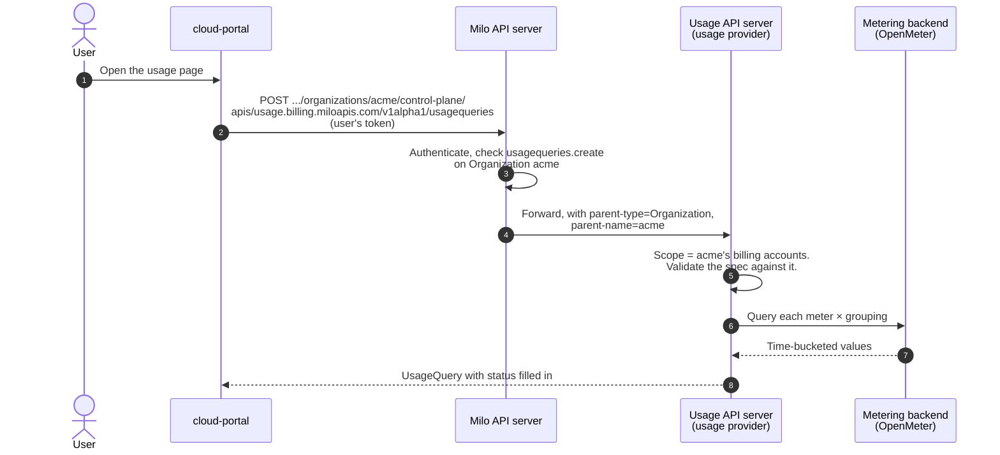

<!-- omit from toc -->
# Usage Query API

- [Summary](#summary)
- [Motivation](#motivation)
  - [Goals](#goals)
  - [Non-Goals](#non-goals)
- [Proposal](#proposal)
  - [How It Works](#how-it-works)
  - [Scope](#scope)
  - [User Stories](#user-stories)
  - [Notes and Constraints](#notes-and-constraints)
  - [Risks and Mitigations](#risks-and-mitigations)
- [Design Details](#design-details)
  - [UsageQuery Resource](#usagequery-resource)
  - [What Lives Where](#what-lives-where)
  - [Provider Implementation Pattern](#provider-implementation-pattern)
  - [IAM](#iam)
- [Future Work](#future-work)
- [Alternatives](#alternatives)

## Summary

`UsageQuery` (`usage.billing.miloapis.com/v1alpha1`) lets the portal, staff
and other clients read metered usage through Milo, with the caller's own
credentials. Milo authenticates and authorizes the request; the usage
provider's aggregated API server reads the request's parent context
(organization, project or platform) and returns only the usage that scope may
see.

Billing owns the API: the types, validation, scope rules and IAM. A usage
provider (openmeter-provider today) implements it against its metering
backend. Clients never talk to the backend directly.

## Motivation

The portal's usage dashboard calls Amberflo's `POST /usage` with a global API
key, and checks access itself by first listing billing accounts as the user.
With OpenMeter there is no API key to hand out: OpenMeter's API has no
authentication, and anyone who can reach it can read and change every
customer's billing data. Giving the portal network access to it would make the
portal a path to all of that.

### Goals

- Read usage with the caller's own Milo credentials. No backend credentials
  or network access outside the provider.
- Enforce tenancy on the server: an organization sees its billing accounts,
  a project sees its own usage, staff see everything.
- Cover what the portal needs today
  ([openmeter-provider#24](https://github.com/milo-os/openmeter-provider/issues/24)):
  a time range, daily buckets, several billing accounts at once, a project
  filter, and breakdowns by any declared dimension.
- Cut the portal's request count: one query returns every meter with all its
  breakdowns.
- Keep the API independent of the metering backend.

### Non-Goals

- Pricing or spend. The portal still works out spend from catalog rates.
- Billing cycles. The client picks the time range; cycle windows stay in the
  portal.
- Writing usage. Usage still enters through the ingestion gateway.

## Proposal

### How It Works



`UsageQuery` is create-only and never stored, like `TokenReview` or
`ResourceSearchQuery`: the client creates one and gets it back with
`status` filled in.

### Scope

Milo sets the request's parent on the caller's identity
(`iam.miloapis.com/parent-type` and `parent-name`) and forwards it to
aggregated API servers. The server derives the scope from it with
`ScopeFromUserExtra`. **The parent sets the boundary; the spec can only
narrow it.**

| Request made in | Billing accounts read | Project filter |
|---|---|---|
| Organization `acme` | All in `organization-acme`, or the ones in `spec.billingAccounts` (which must be in that namespace) | `spec.projects`, optional |
| Project `web` | The one `web` is bound to (active `BillingAccountBinding`) | Always `web`; naming another project is rejected |
| Platform (no parent) | The ones in `spec.billingAccounts`, with namespaces | `spec.projects`, optional |
| Anything else (e.g. a `User` parent) | Rejected | |

A spec that reaches outside its scope is rejected as Forbidden, not answered
with empty results, so a client can tell a mistake from "no usage".

### User Stories

- As an organization member, I see daily usage for my organization's current
  billing cycle, broken down by project and by region.
- As a project member, I see my project's usage, and only my project's.
- As staff, I look at any customer's usage from the staff portal or with
  `kubectl create`.

### Notes and Constraints

- **A separate API group.** An `APIService` takes over a whole group/version,
  so serving `UsageQuery` under `billing.miloapis.com/v1alpha1` would hide
  billing's CRDs. `usage.billing.miloapis.com` follows
  `stripe.billing.miloapis.com`.
- **Aggregations.** Every value uses the meter's own aggregation from its
  MeterDefinition. `total` is computed over the whole range, so it is correct
  for Max, Latest, Average and UniqueCount as well as Sum and Count.
- **Several billing accounts.** Backends report per customer. For Average,
  Latest and UniqueCount, a value that combines several billing accounts
  cannot be exact; providers document how they combine them. Most
  organizations have one billing account.
- **Empty buckets.** Buckets and series without usage are left out, not
  zero-filled. A dimension the events did not set has the value `""`.
- **Limits.** `Validate` caps a query at 100 meters, 10 groupings of up to 3
  dimensions, 50 billing accounts and 50 projects, and the range at 31 days
  hourly, 400 days daily and about 5 years monthly or totals-only.

### Risks and Mitigations

| Risk | Mitigation |
|---|---|
| A bug in scope handling leaks another tenant's usage | Scope rules live in one place in billing (`ScopeFromUserExtra`), with tests; unknown parents are rejected, not treated as the platform |
| A platform request from a non-staff caller | Milo only authorizes a request with no parent against platform-wide permission, which only staff hold. Providers log every platform query with its caller |
| One request fans out into many backend queries | The limits above; providers query in parallel with a bounded pool |

## Design Details

### UsageQuery Resource

```yaml
apiVersion: usage.billing.miloapis.com/v1alpha1
kind: UsageQuery
spec:
  startTime: "2026-10-05T00:00:00Z"   # inclusive
  endTime: "2026-10-13T15:00:00Z"     # exclusive
  granularity: Day                    # Hour | Day | Month; empty = totals only
  timeZone: UTC                       # IANA; default UTC
  billingAccounts: []                 # narrow; empty = all in scope
  projects: []                        # narrow; project_name
  meters: []                          # MeterDefinition names; empty = all published
  groupings:                          # empty = [{groupBy: []}], the total
    - groupBy: []
    - groupBy: [project_name]
    - groupBy: [region]
status:
  scope: { type: Organization, name: acme }
  billingAccounts:
    - { namespace: organization-acme, name: acme-main }
  meters:
    - meterDefinition: compute.miloapis.com-instance-cpu-hours
      meterName: compute.miloapis.com/instance/cpu-hours
      aggregation: Sum
      unit: h
      groupings:
        - groupBy: [region]
          series:
            - group: { region: us-east4 }
              total: "412.5"
              points:
                - { start: "2026-10-05T00:00:00Z", end: "2026-10-06T00:00:00Z", value: "18.2" }
      error: ""                       # set when this meter could not be read
```

Values are decimal strings, because Kubernetes APIs do not use floats.

### What Lives Where

| Piece | Repository |
|---|---|
| Types, defaults, validation, scope rules (`api/usage/v1alpha1`) | billing |
| OpenAPI definitions (`api/usage/openapi`) | billing (generated) |
| `ProtectedResource`, `billing.miloapis.com-usage-viewer` role, discovery policy | billing |
| Aggregated API server, scope resolution against Milo, backend queries | usage provider (openmeter-provider) |
| `APIService` in Milo, deployment, network policies, staff binding | infra |

### Provider Implementation Pattern

A provider's REST storage for `usagequeries`:

1. Calls `SetDefaults` and `Validate`, returning 400 on errors.
2. Calls `ScopeFromUserExtra` on the request's user; 403 on error.
3. Resolves the billing accounts and project filter for the scope, reading
   BillingAccounts, BillingAccountBindings and Projects from Milo, and returns
   403 if the spec reaches outside it.
4. Checks each meter and `groupBy` dimension against the MeterDefinitions
   (declared dimensions plus `status.systemDimensions`); 400 if unknown.
5. Queries the backend for each meter × grouping, plus an un-windowed query
   for totals, and fills `status`.

### IAM

- `ProtectedResource` `usage.billing.miloapis.com-usagequery`: permission
  `create`, parents Organization and Project.
- Role `billing.miloapis.com-usage-viewer` grants
  `usage.billing.miloapis.com/usagequeries.create`.
  `billing.miloapis.com-viewer` inherits it, so everyone who can view
  billing (the organization Viewer, Editor and Owner roles) can view usage.
  Organization bindings apply to the organization's projects too.
- Staff need a `PolicyBinding` of the usage viewer role for platform
  requests, alongside the existing `staff-billing-viewer-*` bindings in
  infra.

## Future Work

- Let project-only members (no organization role) query their project by
  adding the usage viewer role to the project roles.
- A typed Go client, if a Go consumer needs one.

## Alternatives

- **Give the portal network access to OpenMeter** through a GET-only Envoy
  route and NetworkPolicies. It works, but the portal still holds
  cross-tenant access and must enforce tenancy itself.
- **OpenMeter portal tokens.** OpenMeter can sign consumer tokens for one
  read endpoint, but minting them is itself unauthenticated, they are scoped
  by subject rather than customer, and the rest of the API stays open.
- **A namespaced resource.** Simpler authorization, but it cannot express
  project or platform scope, and staff would need one query per
  organization.
